<div align="center">

# 🧠 Brain Tumor Detection from MRI

**Binary classification of brain MRI scans (Brain Tumor vs. Healthy) with PyTorch —
comparing a from-scratch CNN against transfer-learned ResNet18 and MobileNetV2, with Grad-CAM explainability.**


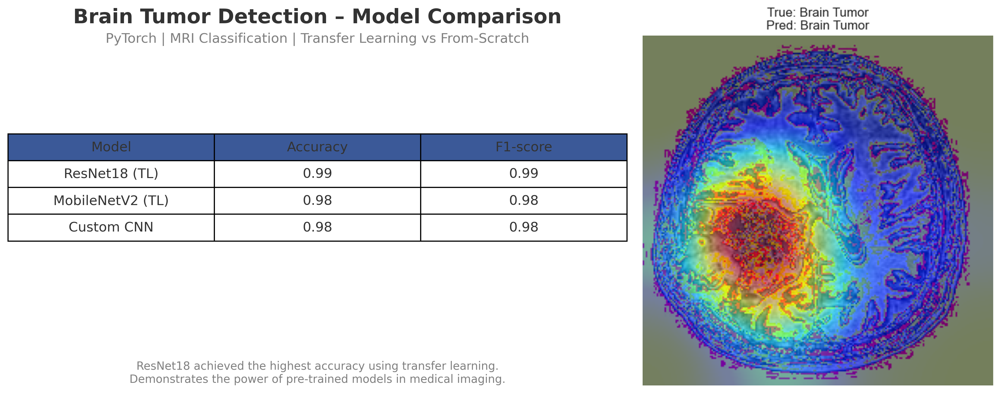

</div>

---

## 📌 Overview

Early detection of brain tumors significantly improves treatment outcomes, but manual review of MRI scans is slow and subject to human error. This project builds and compares three deep-learning classifiers that label an MRI slice as **Brain Tumor** or **Healthy**:

| # | Model | Approach | Input |
|---|-------|----------|-------|
| 1 | **CNN_TUMOR** | Custom 4-block CNN trained from scratch | 256 × 256 |
| 2 | **ResNet18** | ImageNet-pretrained, `layer4` fine-tuned + new classifier head | 224 × 224 |
| 3 | **MobileNetV2** | ImageNet-pretrained, frozen features + new classifier head | 224 × 224 |

Model decisions are made interpretable with **Grad-CAM** heat-maps that highlight the regions driving each prediction.

## 🏆 Results

Evaluated on the held-out validation split (**921 images**: 503 tumor / 418 healthy).

| Model | Accuracy | F1-score (macro) | ROC-AUC | PR-AP |
|-------|:--------:|:----------------:|:-------:|:-----:|
| **ResNet18 (TL)** | **0.99** | **0.99** | 1.00 | — |
| MobileNetV2 (TL) | 0.98 | 0.98 | 1.00 | 1.00 |
| Custom CNN | 0.98 | 0.98 | 1.00 | 1.00 |

ResNet18 misclassified only **5 of 921** validation images (2 tumor → healthy, 3 healthy → tumor).

<p align="center">
  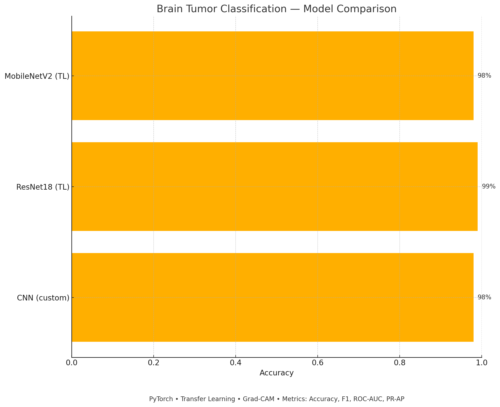
</p>

<details>
<summary><b>📈 Training curves</b></summary>

| Custom CNN (60 epochs) | ResNet18 (30 epochs) | MobileNetV2 (30 epochs) |
|:---:|:---:|:---:|
| 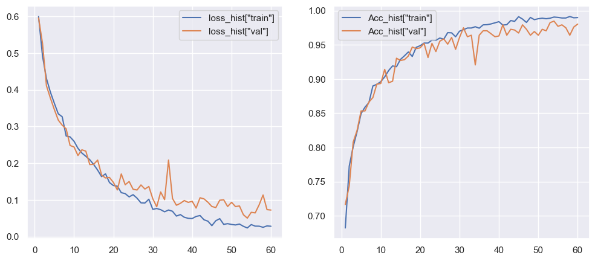 | 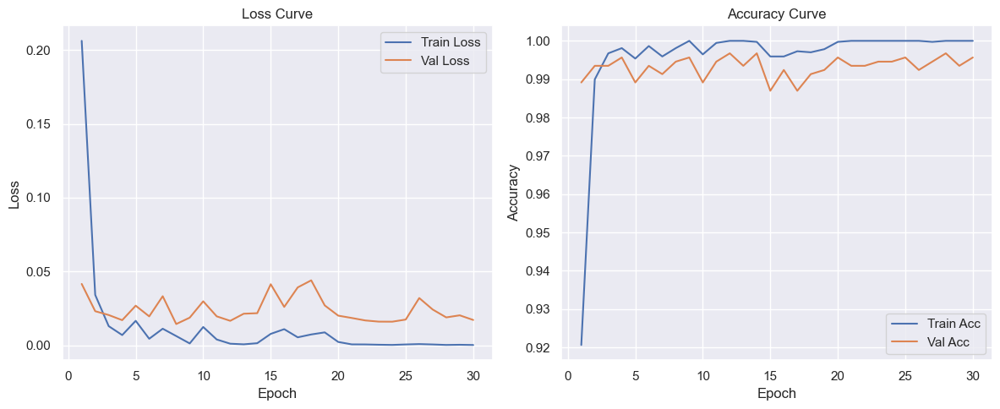 | 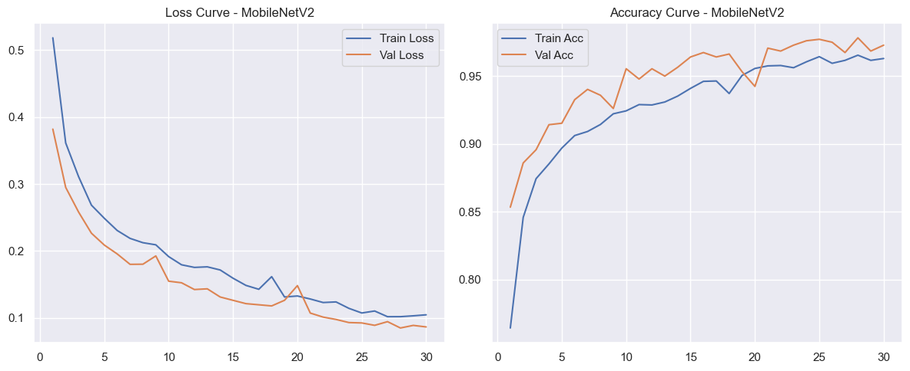 |

</details>

<details>
<summary><b>🧮 Confusion matrices</b></summary>

| Custom CNN | ResNet18 | MobileNetV2 |
|:---:|:---:|:---:|
| 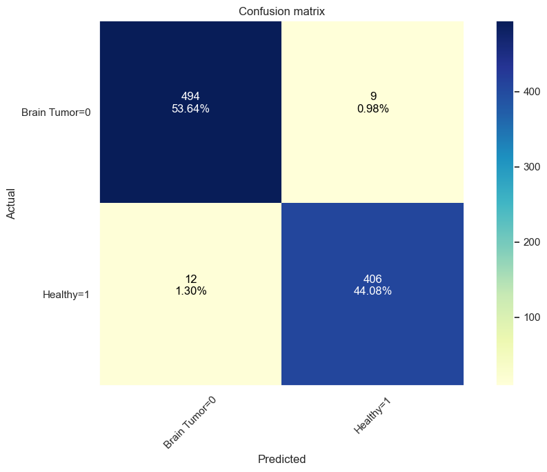 |  | 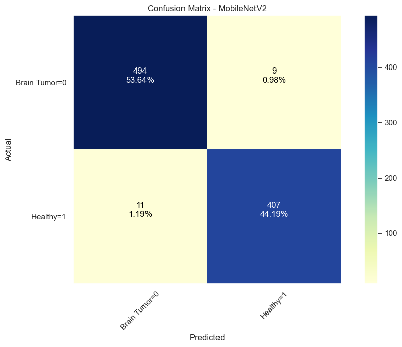 |

</details>

<details>
<summary><b>🔥 Grad-CAM explainability</b></summary>

| Custom CNN (`conv4`) | ResNet18 (`layer4`) |
|:---:|:---:|
| 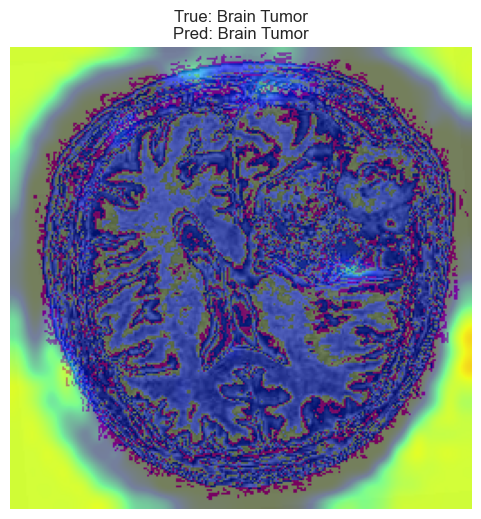 | 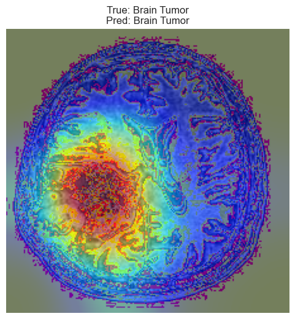 |

</details>

<details>
<summary><b>❌ Misclassified examples (ResNet18)</b></summary>

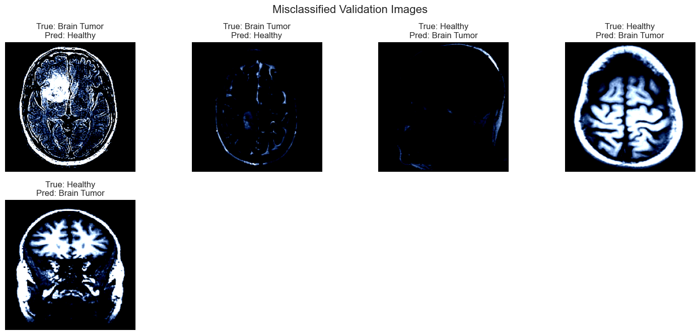

</details>

## 🗂️ Dataset

- **4,600 MRI images** in two classes — `Brain Tumor` and `Healthy` — with a `metadata.csv` describing each file (format, colour mode, shape).
- Mixed formats (JPEG / PNG / TIFF) and resolutions (e.g. 512×512, 300×240, 256×256).
- Split **80 / 20** into train / validation with [`split-folders`](https://pypi.org/project/split-folders/) (`seed=20`).

<p align="center">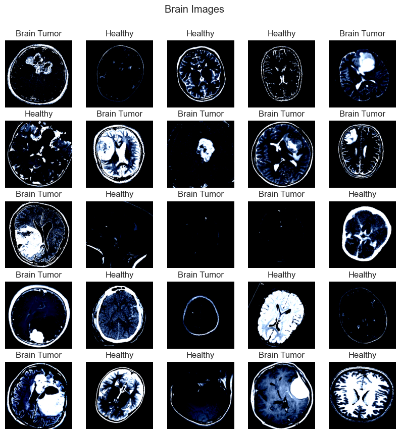</p>

> The dataset is not included in this repository. Place it locally as:
> ```
> Brain Tumor Data Set/
> ├── Brain Tumor/
> ├── Healthy/
> └── metadata.csv
> ```

## ⚙️ Methodology

**Pre-processing & augmentation**
- Custom CNN: resize 256×256, random horizontal/vertical flips, random rotation ±30°, ImageNet normalisation.
- Transfer models: resize 224×224, ImageNet normalisation.

**Training setup**
- Loss: `NLLLoss` on `LogSoftmax` outputs (equivalent to cross-entropy).
- Optimiser: Adam (`lr = 3e-4` for CNN, `1e-4` for transfer models).
- Scheduler: `ReduceLROnPlateau` (factor 0.5); the best weights by validation loss are checkpointed and restored.
- Hardware: CPU only (PyTorch 2.8).

**Evaluation**
- Accuracy, precision, recall, F1, confusion matrix, ROC-AUC, precision-recall AP, misclassification review, Grad-CAM (`torchcam`).

## 📁 Repository Structure

```
brain-tumor-mri-classification/
├── notebooks/
│   └── BT_project.ipynb          # Full pipeline: EDA → training → evaluation → Grad-CAM
├── src/
│   ├── models.py                 # CNN_TUMOR, ResNet18 & MobileNetV2 builders, load_model()
│   └── predict.py                # Command-line inference on images / folders
├── models/
│   └── cnn_tumor.pt              # Trained custom-CNN weights (state_dict)
├── assets/                       # Figures used in this README
├── docs/
│   └── Brain_Tumor_Classification_Report.docx
├── requirements.txt
├── LICENSE
└── README.md
```

**Pre-trained weights:** `cnn_tumor.pt` is in `models/`. The ResNet18 weights (`resnet18_brain.pt`, 45 MB) are attached to the [**latest release**](../../releases/latest) — download and place them in `models/`.

## 🚀 Quick Start

```bash
git clone https://github.com/<your-username>/brain-tumor-mri-classification.git
cd brain-tumor-mri-classification
pip install -r requirements.txt
```

**Predict with the custom CNN**
```bash
python src/predict.py --arch cnn --weights models/cnn_tumor.pt path/to/mri.jpg
```

**Predict with ResNet18** (after downloading the weights from Releases)
```bash
python src/predict.py --arch resnet18 --weights models/resnet18_brain.pt path/to/folder_of_scans/
```

Example output:
```
axial_t2.jpg                             -> Healthy      (99.84%)
```

**Use in Python**
```python
from src.models import load_model
model = load_model("resnet18", "models/resnet18_brain.pt")
```

**Reproduce training** — open `notebooks/BT_project.ipynb`, update the dataset paths in the first cells, and run all.

## ⚠️ Limitations & Future Work

- Metrics are reported on a single validation split that was also used for checkpoint selection; a separate held-out test set and k-fold cross-validation would give a less optimistic estimate.
- The dataset contains the same scans in several file formats; de-duplicating before splitting would rule out train/validation leakage.
- Binary task only — extending to multi-class tumor types (glioma, meningioma, pituitary) is a natural next step.
- Planned: a Streamlit web app for drag-and-drop inference with live Grad-CAM.

> **Disclaimer:** This project is for research and educational purposes only and is **not** a medical device. It must not be used for clinical diagnosis.

## 👤 Author

**Dr. Prabhu Raj Singh**

If you find this project useful, please ⭐ the repository!

## 📄 License

Released under the [MIT License](LICENSE).
